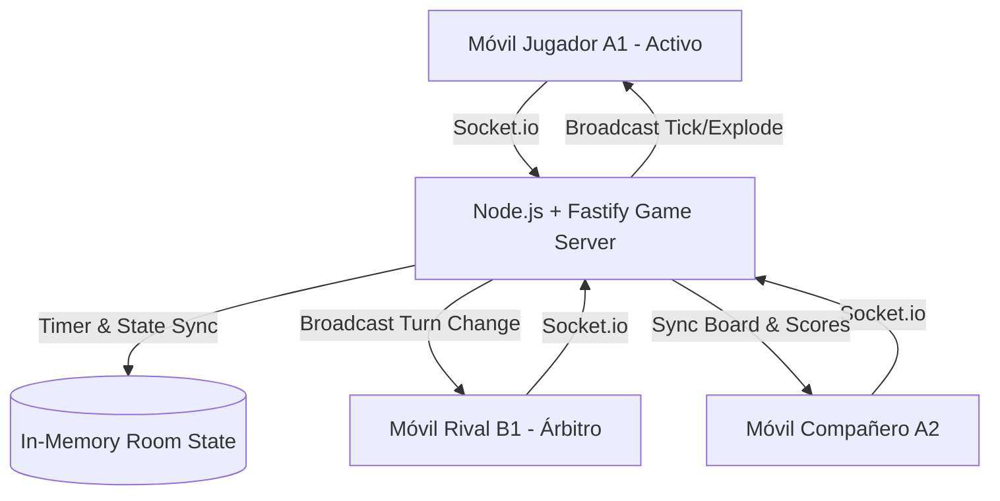

# Requirements

### Visión General y Objetivos
> **Nombre y tema (decidido 2026-10-15):** el juego pasa a llamarse **«¡Desactívala! ¡Rápido!»** (en inglés **«Defuse it! Fast!»**; antes «¡Solo desactívala rápido!») con temática de **bombas y artificieros** (sustituye a la marca *Expresión Express* y a la patata). Ver *Step 8b* para el detalle del rebranding.

**Expresión Express Digital** es una adaptación web multidispositivo en tiempo real del clásico party game de 1996. Cada participante juega desde su propio smartphone conectado a una sala común.

El sistema digital conserva la emoción física de la "patata caliente" y el aceleramiento frenético del temporizador, pero soluciona las limitaciones del juego físico tradicional:
1. **Eliminación del estancamiento intencionado**: Recompensa la rapidez en adivinar con "Power-ups" tácticos para evitar que los jugadores retengan palabras sencillas esperando el pitido final.
2. **Rol de arbitraje interactivo y mediación social**: Los rivales ven la palabra en su móvil y disponen de un botón de falta para sancionar pistas ilegales. Para evitar usos maliciosos del botón que puedan arruinar la partida, la ronda se detiene en seco para una mediación social donde el anfitrión puede asignar el punto al equipo que se acuerde o reiniciar la ronda desde cero con nuevas palabras y temporizador fresco.
3. **Inmersión sensorial personalizada**: El sonido acelerado de tic-tac y la vibración háptica se reproducen específicamente en el móvil del jugador que tiene la patata en ese instante, simulando una bomba en mano.
4. **Variabilidad y rejugabilidad infinita**: Soporte para mazos temáticos predeterminados y creación de mazos personalizados.

### Alcance (Scope)
#### Dentro del Alcance (In Scope)
- Aplicación Web Progresiva (PWA) multidispositivo sin necesidad de descargas ni registro obligatorio.
- Sistema de salas mediante código alfanumérico de 4 caracteres o código QR.
- División de participantes en dos equipos (Equipo A y Equipo B) con orden alterno circular automático.
- Motor de temporizador autoritativo en servidor con duración aleatoria secreta y aceleración de pulsos.
- Vistas asimétricas según el rol en cada instante (Portador de la patata, Árbitro rival, Compañero adivinador).
- Motor de sonido procedural en cliente con Web Audio API y vibración háptica con Web Vibration API.
- Sistema de Power-ups por velocidad de acierto y casillas especiales en el tablero.
- Botón de infracción/falta para rivales con sistema de mediación del anfitrión (pausa de ronda, resolución a favor de un equipo o reinicio de ronda).
- Tablero visual de avance por casillas y pantalla de podio final.
- Panel de administración protegido para creación y gestión de mazos y categorías de palabras (acceso restringido a administradores).
- Arquitectura de catálogo preparada para futura monetización mediante compra de packs de palabras temáticas/prémium.

#### Fuera del Alcance (Out of Scope)
- Chat de voz o videollamada integrada (el juego está diseñado para jugar en presencia física o en llamada externa Discord/Meet).
- Pasarela de pago activa en fase inicial (se estructura el catálogo y modelos para compra de packs, difiriendo la integración del procesador de pagos a una fase posterior).
- Matchmaking público aleatorio con desconocidos (diseñado para salas privadas entre amigos).

### Historias de Usuario (User Stories)
- **Como Anfitrión de la sala**, quiero crear una partida, configurar las rondas/mazos, compartir un código QR y resolver disputas de faltas pudiendo fallar a favor de un equipo o reiniciar la ronda.
- **Como Jugador activo (Portador)**, quiero ver con claridad la palabra que tengo que hacer adivinar, sentir la vibración y el tic-tac acelerándose en mi mano, y pulsar "Acertado" para pasarle de inmediato la patata al rival.
- **Como Rival (Árbitro)**, quiero ver la palabra que el equipo contrario intenta adivinar para vigilar que no hagan trampas y poder pulsar "¡Falta!" si dicen una palabra prohibida, deteniendo la ronda para revisión.
- **Como Miembro del equipo**, quiero adivinar rápido la palabra para que mi equipo gane power-ups tácticos (como rebotar la patata o forzar al rival a acertar dos palabras).
- **Como Administrador**, quiero acceder a un panel privado y protegido para crear, editar y organizar los packs de palabras y configurar si son packs estándar o prémium para su futura monetización.
- **Como Grupo de amigos**, queremos ver el tablero de casillas para celebrar los avances y la victoria final de nuestro equipo.

### Requisitos No Funcionales
- **Baja latencia en tiempo real**: Eventos de pase de turno transmitidos en <100ms mediante WebSockets.
- **Mobile first** (decidido): el juego se juega en móviles; el PC solo se usa para probar. Toda pantalla se diseña primero para 375–430 px de ancho y una sola mano:
  - La acción principal de cada pantalla va **fija abajo** (zona del pulgar) y debe verse sin hacer scroll incluso en un iPhone SE (375×667).
  - Cabecera mínima (título, estado, menú ⋮); los controles secundarios van en el menú.
  - Objetivos táctiles de al menos 44 px; ventanas modales como hojas que suben desde abajo; respetar las zonas seguras (`env(safe-area-inset-*)`) y usar `dvh`.
  - Durante la partida, marcador compacto en una línea; el tablero completo solo entre rondas.
  - Verificación visual con capturas en viewport móvil (390×844 y 375×667) de todo el flujo.
- **Poca información en pantalla** (decidido; feedback de una jugadora con TDAH, vale para todos en un juego con prisa): cada pantalla de juego muestra solo **qué eres, lo grande (cable o «¡ADIVINA!») y un botón**. Nada de frases explicativas ni reglas durante la partida: las reglas están en «❓ Cómo se juega» del menú. Las herramientas solo aparecen cuando se pueden usar.
- **Resiliencia ante reconexiones**: Si un jugador pierde conexión brevemente, el servidor preserva su estado y sincroniza la vista al reconectar.
- **Imparcialidad garantizada**: El tiempo de detonación se calcula y almacena exclusivamente en memoria del servidor, evitando cualquier lectura o manipulación por parte del cliente.

# Technical Design

### Vocabulario del juego
Términos que usamos para hablar del juego (fuente de verdad en código: `src/client/i18n/locales/es/common.ts`; cada idioma puede tener sus propios nombres):

| Término | Significado |
|---|---|
| **Bomba** | Lo que se pasa de mano en mano; explota a un tiempo secreto. |
| **Cable** | La palabra que hay que hacer adivinar. Acertar = **cortar el cable**. |
| **Artificiero** | Quien tiene la bomba en este momento y da pistas del cable. |
| **Ayudantes** | Los compañeros de equipo del artificiero; adivinan el cable. |
| **Saboteadores** | El equipo rival del artificiero; vigilan, cantan faltas y usan herramientas ofensivas. |
| **Anfitrión** | Quien creó la sala; arranca rondas y resuelve disputas. |
| **Herramientas** | Los power-ups (Devolver al remitente, Otro cable, Doble detonador, Inhibidor, …). |
| **Equipo Rojo / Equipo Azul** | Los dos equipos (A / B en el código). |

### Reglas de las pistas
- El artificiero puede usar **cualquier recurso**: palabras, mímica, gestos, sonidos, señalar...
- ✓ **Las faltas las deciden los jugadores**, no la app: el texto en pantalla es solo una guía con un ejemplo («lugar donde hay perros» para «perrera»). Si alguien cree que una pista se pasa, mantiene pulsado «¡Falta!» y la mesa lo resuelve; el anfitrión asigna el punto o reinicia la ronda. Sin lista cerrada de faltas (traducir, deletrear, rimas… lo decide la mesa).

### Arquitectura General del Sistema
El sistema sigue una arquitectura cliente-servidor orientada a eventos en tiempo real con WebSockets:



### Componentes Principales

#### Estructura del repositorio
- `src/core/`: Motores de reglas puros y testeables sin dependencias de red (`RoomManager`, `TimerEngine`, `TurnManager`, `PowerUpEngine`, `DeckEngine`, `BoardEngine`, `DisputeEngine`).
- `src/server/`: Orquestación en tiempo real (`GameSession`, `GameSessionManager`, `socketHandler`, `protocol.ts`, `server.ts`).
- `src/main.ts`: Punto de arranque del servidor (`npm run dev` levanta servidor + Vite; `npm start` sirve el build).
- `src/client/`: Cliente React (Vite + Tailwind vía CDN).

#### 1. Servidor de Juego (`src/core/` + `src/server/`)
- `server.ts`: Servidor Fastify con integración de Socket.io y endpoints REST protegidos para administración y catálogo de packs de palabras.
- `RoomManager.ts`: Registro central de salas activas, gestión de jugadores, asignación a Equipo A / Equipo B y reconexiones.
- `TimerEngine.ts`: Gestiona el reloj oculto de la ronda. Selecciona un tiempo aleatorio entre $T_{min}$ y $T_{max}$ (ej. 35 a 65 segundos). Emite eventos de frecuencia creciente (`tick`) calculados con una curva exponencial $f(t) = f_0 \cdot e^{k \cdot t}$.
- `TurnManager.ts`: Controla el puntero de turno circular ($A_1 \rightarrow B_1 \rightarrow A_2 \rightarrow B_2 \dots$).
- `PowerUpEngine.ts`: Evalúa el tiempo transcurrido en el acierto. Si $t_{acierto} < 5\text{s}$, añade una carga de poder al equipo activo. Procesa la activación de poderes (*Rebote*, *Doble Reto*, *Congelar*, *Salto*).
- `DeckEngine.ts`: Carga los bancos de palabras, baraja los discos virtuales y entrega palabras únicas asegurando que ningún disco se repita en la partida. Maneja catálogo de packs estándar y prémium.

#### 2. Cliente Frontend (`src/client/`)
- `services/socketService.ts`: Cliente Socket.io tipado con reconexión automática.
- `services/audioService.ts`: Sintetizador Web Audio API que genera osciladores de pulsos (ondas cuadradas / senoidales) modulando frecuencia y duración, evitando la carga de archivos de audio pesados.
- `services/hapticService.ts`: Wrapper de la API `navigator.vibrate` sincronizado con los pulsos de audio del jugador activo.
- `components/views/ActiveGiverView.tsx`: Vista para el portador de la patata con botón principal de "¡Acertado! / Pasar" y tarjeta de palabra.
- `components/views/OpponentRefereeView.tsx`: Vista para el equipo rival mostrando la palabra activa y el botón de "¡Falta / Trampa!".
- `components/views/TeamMateView.tsx`: Vista de soporte para compañeros con visualización de rachas y estado de power-ups.
- `components/views/HostDisputeModal.tsx`: Panel exclusivo del anfitrión que se activa durante una falta para pausar el temporizador y decidir: dar la ronda al Equipo A, al Equipo B, o reiniciar la ronda.
- `components/board/GameBoard.tsx`: Tablero de casillas interactivo con avatares de equipo y casillas especiales.
- `components/admin/AdminDeckEditor.tsx`: Panel de administración protegido (mediante contraseña/token de admin) para crear, editar, catalogar y marcar packs como prémium o estándar.

### Protocolo de Eventos en Tiempo Real (Socket Events)
- `room:create` / `room:join` / `room:state`: Gestión del lobby y asignación de equipos.
- `game:start_round`: Inicio de ronda con asignación del primer portador.
- `turn:guess_success`: El portador acierta la palabra. El servidor evalúa la velocidad, actualiza la patata al siguiente jugador y emite `turn:changed`.
- `turn:foul_triggered`: Un árbitro rival pulsa "Falta". El servidor pausa de inmediato el temporizador, congela la ronda y emite `game:dispute_started` a todos los jugadores, abriendo las opciones de decisión en el terminal del anfitrión.
- `host:resolve_dispute`: El anfitrión envía la resolución (`AWARD_TEAM_A`, `AWARD_TEAM_B` o `RESTART_ROUND`). El servidor actualiza puntuaciones/tablero o reinicia la ronda con nuevas palabras y temporizador restablecido, emitiendo `game:dispute_resolved`.
- `powerup:use`: Un equipo activa un power-up almacenado.
- `timer:tick`: Emitido periódicamente con el identificador del jugador activo para reproducir sonido y vibración local.
- `timer:exploded`: La patata explota. El equipo del portador pierde la ronda, el equipo rival avanza en el tablero y se muestra la pantalla de resumen.

### Estructura de Datos (Modelos)

```typescript
export interface Player {
  id: string;
  name: string;
  team: 'A' | 'B';
  isHost: boolean;
  seatIndex: number;
}

export interface PowerUp {
  id: string;
  type: 'REVERSE' | 'DOUBLE_BURDEN' | 'FREEZE' | 'SKIP';
  name: string;
  description: string;
}

export interface WordPack {
  id: string;
  name: string;
  description: string;
  category: string;
  isPremium: boolean;
  priceTier?: 'FREE' | 'TIER_1' | 'TIER_2';
  words: string[];
}

export interface DisputeState {
  triggeredByPlayerId: string;
  triggeredByTeam: 'A' | 'B';
  foulReason?: string;
  timestamp: number;
}

export interface GameState {
  roomCode: string;
  status: 'LOBBY' | 'PLAYING' | 'DISPUTE_PAUSED' | 'ROUND_OVER' | 'GAME_OVER';
  scores: { A: number; B: number };
  targetScore: number;
  currentDispute?: DisputeState;
  currentTurn: {
    activePlayerId: string;
    activeTeam: 'A' | 'B';
    currentWord: string;
    category: string;
    turnStartTime: number;
  };
  teamInventory: {
    A: PowerUp[];
    B: PowerUp[];
  };
  boardTiles: BoardTile[];
}
```

# Testing

### Enfoque de Validación
La verificación se estructurará en pruebas unitarias de lógica de juego, pruebas de integración de sockets y pruebas de interfaz en navegador móvil.

### Escenarios Principales a Validar
1. **Flujo de Conexión y Salas**:
   - Creación de sala con código único de 4 letras.
   - Conexión de múltiples clientes (mínimo 4 jugadores: 2 en Equipo A, 2 en Equipo B).
   - Reordenación y asignación de asientos.
2. **Ciclo de Turno y Rotación**:
   - Inicio de ronda con palabra asignada.
   - Pulsación de '¡Acertado!' transfiere inmediatamente el rol y la palabra al siguiente rival ($A_1 \rightarrow B_1$).
   - Verificación de que solo el jugador activo emite sonido/vibración.
3. **Mecanismo de Infracción (Botón de Falta) y Arbitraje del Anfitrión**:
   - Pulsación del botón de falta por parte de un rival pausa el temporizador en el servidor y congela la ronda en todos los clientes.
   - El anfitrión recibe el panel de mediación con las opciones: otorgar victoria de ronda al Equipo A, al Equipo B, o reiniciar la ronda completa.
   - Verificación de la correcta aplicación del resultado arbitral y reanudación o reinicio de estados de temporizador y turnos.
4. **Sistema Anti-Estancamiento y Power-ups**:
   - Acierto en $<5$ segundos añade correctamente un Power-up al inventario del equipo.
   - Activación de *Rebote* devuelve el turno al jugador anterior.
   - Activación de *Doble Reto* exige dos aciertos consecutivos antes de permitir el pase de patata.
5. **Detonación y Tablero de Puntuación**:
   - Al finalizar el tiempo secreto, emisión de `timer:exploded`.
   - El equipo contrario al portador activo suma 1 punto y avanza en el tablero de casillas.
   - Victoria y pantalla de podio al alcanzar la casilla final.

### Casos Límite y Resiliencia
- **Desconexión del jugador activo**: Si el móvil del jugador con la patata se desconecta durante una ronda, el servidor reasigna la patata al siguiente jugador del mismo equipo para evitar que la partida se bloquee.
- **Latencia de red asíncrona**: El servidor descarta eventos `guess_success` recibidos después del timestamp de detonación `timer:exploded`.
- **Desactivación de audio/vibración**: Soporte visual alternativo (parpadeo en pantalla completa) para navegadores que bloqueen la vibración o audio sin interacción previa.

# Delivery Steps

### ✓ Step 1: Especificaciones ejecutables y suite de validación del motor de juego
Definir e implementar las especificaciones ejecutables y suites de pruebas automatizadas (BDD / contratos de prueba) que definen el comportamiento de todas las reglas del juego:
- Especificaciones ejecutables para el ciclo de vida de salas, asignación equilibrada de equipos y orden de asientos circulares.
- Especificaciones ejecutables para el temporizador autoritativo (cálculo de duración aleatoria secreta y curva de aceleración exponencial de pulsos).
- Especificaciones ejecutables para la rotación de turnos asimétricos ($A_1 \to B_1 \to A_2 \to B_2$) y detección de velocidad de acierto (<5s).
- Especificaciones ejecutables para el protocolo de faltas, congelación de ronda y resolución arbitral por parte del anfitrión (asignar punto a Equipo A/B o reiniciar ronda).
- Especificaciones ejecutables para el catálogo de palabras y generador de discos virtuales sin repetición.
- Especificaciones ejecutables para la activación e inventario de power-ups tácticos (*Rebote*, *Doble Reto*, *Congelar*, *Salto*).

### ✓ Step 2: Configuración del backend y motor de salas en tiempo real
Establecer el backend en Node.js/TypeScript con Fastify y Socket.io para gestionar salas de juego y el bucle autoritativo del temporizador.

- Inicializar el proyecto con TypeScript, Fastify y Socket.io.
- Implementar `RoomManager` para la creación y gestión del ciclo de vida de salas (códigos de 4 letras, control de anfitrión, lista de jugadores y asignación a Equipos A y B).
- Crear el motor de temporizador aleatorio en servidor (`TimerEngine`) con intervalos de aceleración progresiva y emisión de eventos de tick y detonación.
- Diseñar el orquestador de turnos circulares (`TurnManager`) para alternar automáticamente entre `A1 -> B1 -> A2 -> B2`.
- Integración completa en `GameSession`, `GameSessionManager`, `socketHandler` y `server.ts` con API REST complementaria y suite de tests de integración en tiempo real.

### ✓ Step 3: Sistema de mazos, categorías y generador de palabras
Implementar el catálogo de palabras organizado por categorías temáticas, panel de administración protegido y arquitectura para packs prémium.

- Crear las colecciones base de palabras y categorías temáticas (Clásico 1996, Cultura Pop, Cine/Series, Fiesta).
- Implementar el generador de discos virtuales (`DeckEngine`) con algoritmos de barajado sin repetición de palabras por partida, sanitización y deduplicación.
- Desarrollar la API REST protegida y el panel de administración privado (`AdminDeckEditor`) para que solo administradores creen, editen, eliminen, importen y exporten packs de palabras (con atributos para packs estándar y futuros packs prémium monetizables).

### ✓ Step 4: Esqueleto del cliente web y entorno de desarrollo
Cliente React + Vite + Tailwind con todas las pantallas maquetadas y conectadas al protocolo de sockets.

- Vite + React + TypeScript + Tailwind; `npm run dev` arranca servidor (`src/main.ts`, tsx watch) y cliente (proxy `/api` y `/socket.io`).
- Pantallas de inicio (crear / unirse por código o enlace `?room=`), Lobby con selección de equipo y vista previa del orden de turnos.
- Vistas por rol (Portador, Árbitro rival, Compañero), modal de disputa del anfitrión, tablero y podio maquetados.
- `GameContext` + `socketService` tipados; servicios de audio procedural y vibración.

> **Auditoría (2026-10-15):** las vistas existen pero el bucle de juego no es completable: no hay pantalla de `ROUND_OVER`, el reinicio tras `GAME_OVER` es rechazado por el servidor, no hay reconexión real y varios power-ups/casillas solo existen en los motores. Los pasos siguientes cubren esas brechas por orden de prioridad.

### ✓ Step 5: Bucle de juego completo y jugable de principio a fin
Que una partida pueda jugarse entera (varias rondas hasta el podio y revancha) sin quedarse bloqueada.

- Pantalla de **resumen de ronda** (`ROUND_OVER`): quién tenía la patata al explotar, equipo que puntúa, marcador y tablero; botón "Siguiente ronda" solo para el anfitrión.
- Resumen tras resolución de disputa con punto asignado (mismo flujo `ROUND_OVER`).
- **Revancha / volver al lobby** desde `GAME_OVER`: nuevo evento `game:return_to_lobby` (solo anfitrión) que resetea marcador, inventarios, ronda y mazo conservando jugadores y equipos.
- "Salir al menú" abandona realmente la sala en el servidor (`room:leave`).
- Corregir el cálculo del ganador en `GameOverView` (precedencia del operador ternario).
- Mostrar errores de acciones fallidas (callbacks `success: false`) en todas las vistas de juego, no solo en Home/Lobby.

### ✓ Step 5b: Internacionalización (i18n) desde el principio
Todo texto visible es traducible y cada idioma puede tener textos propios (no solo traducción literal).

- Sistema propio y tipado, sin dependencias: `src/client/i18n/` con `I18nProvider` y `useI18n()` → `t.<área>.<clave>`.
- Diccionarios por idioma y área (`locales/<idioma>/{common,errors,home,lobby,game,admin}`). El **español es la referencia**: su forma define el tipo `Messages`, y cualquier otro idioma con claves de menos o de más **no compila**. Un test comprueba además que todos los idiomas tienen la misma estructura (incluida la longitud de listas) y ningún texto vacío.
- Mensajes con parámetros/plurales como funciones (`connectedPlayers(n)`); mensajes con formato (negritas) como funciones que devuelven JSX, para que cada idioma pueda reordenar la frase.
- Idioma por dispositivo: guardado en `localStorage`, si no el del navegador, si no español. Selector en la cabecera; actualiza `<html lang>` y el título.
- **El servidor no envía textos para mostrar**: errores con código estable (`GameError` + `GameErrorCode` en `src/core/errors.ts`, campo `code` obligatorio en `ApiResponse`), herramientas por `type` sin nombre/descripción, activaciones sin texto. El cliente traduce. Así una misma sala puede mezclar jugadores en distintos idiomas.
- Idiomas iniciales: **español** (completo) e **inglés**. ✓ Nombre en inglés: **«Defuse it! Fast!»**.
- ✓ Mazos por idioma: **más adelante** (cuando haya mazos en otros idiomas).
- Regla para todo el trabajo futuro: ningún texto visible hard-coded en componentes ni en mensajes del servidor; cada código de error nuevo necesita su traducción en todos los idiomas.
- ? Pendiente de decidir: **mazos de palabras por idioma** (campo `language` en `WordPack`, filtro en el selector de mazos y en el panel de administración). Las palabras son contenido, no se traducen.

### ✓ Step 6: Resiliencia de conexión y recarga de página
Cumplir el requisito no funcional de reconexión.

- ✓ **La URL identifica la sala** (`/r/ABCD`; los enlaces antiguos `?room=` siguen funcionando). El estado de la partida no va en la URL: lo manda el servidor.
- ✓ **Token secreto de sesión** por jugador (`room:create` / `room:join` lo devuelven; solo lo recibe ese dispositivo). Se guarda en `sessionStorage` (por pestaña, sobrevive a F5; varias pestañas del mismo navegador pueden ser jugadores distintos).
- ✓ Al recargar o reconectarse el socket, el cliente llama a `room:rejoin { roomCode, sessionToken }` y recupera el mismo jugador (incluido el rol de anfitrión). Si la sala ya no existe o el token no vale (`ROOM_NOT_FOUND` / `SESSION_EXPIRED`), se muestra el formulario de unirse con ese código.
- ✓ Corregido agujero de seguridad: `room:join` ya no acepta un `playerId` del cliente (los ids son públicos; cualquiera podía suplantar a otro jugador, incluido el anfitrión).
- ✓ Un `disconnect` tardío del socket anterior no marca como desconectado a un jugador que ya ha vuelto con otro socket.
- ✓ Artificiero desconectado: **periodo de gracia** configurable (`disconnectGraceSec`, 5 s por defecto) y después la bomba pasa al **siguiente compañero conectado de su equipo** (si no queda ninguno, al rival). La bomba sigue corriendo durante la gracia.
- ✓ Pantalla "Volviendo a la sala…" durante la recarga; indicador "desconectado" en el lobby. "Atrás" del navegador no saca de la sala (solo el botón Salir).
- ? Limitación conocida: cerrar la pestaña pierde la sesión (`sessionStorage`). Valorar en pruebas reales si en móvil hace falta persistir más (p. ej. `localStorage` con identificador de pestaña).
- Pendiente para otros pasos: indicador de desconectados durante la partida; limpiar salas abandonadas (si todos se desconectan la sala queda en memoria); en producción el servidor debe servir `index.html` para `/r/*` (Step 9).

### ✓ Step 7: Configuración de partida del anfitrión y QR
- ✓ Ajustes centralizados en `src/core/settings.ts`: valores por defecto (`DEFAULT_SETTINGS`) y validación de cordura en servidor (`resolveSettings`, error `INVALID_SETTINGS`), tanto al crear la sala como al cambiarlos. Nada de reglas hard-coded.
- ✓ Ajustes nuevos: herramientas permitidas por tipo (`enabledPowerUps`), máximo por equipo (`maxPowerUpsPerTeam`, 2 por defecto; con el inventario lleno no se gana ninguna), duración del Inhibidor (`freezeDurationSec`, 3 s), espera por desconexión (`disconnectGraceSec`, 5 s).
- ✓ Los ajustes **se aplican de verdad**: `GameSession.applySettings()` reconfigura temporizador (rango de duración), turnos y herramientas (umbral de acierto rápido, tipos, límite) y tablero (puntos para ganar).
- ✓ Los ajustes viajan en `GameState.settings`: todos los jugadores ven las reglas; solo el anfitrión las cambia.
- ✓ Lobby: panel de ajustes con botones −/+ (rangos jugables en la UI, más estrechos que los límites del servidor), interruptor de herramientas y selección por tipo; selector de mazo (editable por el anfitrión, visible para todos); **código QR** del enlace `/r/ABCD`, generado en el navegador (librería `qrcode`).

### ✓ Step 7b: Separar la sala de la partida
Una **sala** es el grupo de gente reunida (dura toda la sesión); dentro se juegan varias **partidas**, cada una con sus mazos y ajustes. "Crear partida" pasa a ser **"Crear sala"**.

- **Sala** (`RoomState`): código/URL, anfitrión, jugadores con equipos y asientos (se mantienen entre partidas), conexiones y tokens, **preparación de la próxima partida** (`setup`: ajustes + mazos; se conserva la última usada) e **historial** (`GameSummary[]`, en memoria).
- **Partida** (`GameState`): número de partida, copia congelada de los ajustes, **uno o varios mazos combinados** (`packIds`; palabras deduplicadas, cada una con su categoría), participantes, marcador, rondas, tablero, herramientas, temporizador, disputas.
- ✓ Decidido: quien entra en la sala con una partida empezada **es espectador hasta la siguiente** (ve el tablero, no la palabra).
- ✓ Decidido: el anfitrión puede **terminar la partida antes de tiempo** (con confirmación); queda en el historial como no terminada.
- ✓ Decidido: **historial sencillo** de partidas de la sala (mazos y resultado).
- Cambios de equipo y de preparación solo sin partida en curso. Las acciones de partida exigen ser participante (`NOT_A_PARTICIPANT`); las de anfitrión (siguiente ronda, resolver disputa, terminar) las comprueba la sala aunque el anfitrión sea espectador.
- Protocolo (`src/server/protocol.ts`): el servidor envía siempre `RoomSnapshot = { room, game | null }` en `room:state_updated`. Eventos nuevos: `room:update_setup` (sustituye a `room:select_pack` y `room:update_settings`), `game:start`, `game:end` (sustituye a `game:return_to_lobby`). Desaparecen `room:player_joined/left/reconnected` (los cubre `room:state_updated`).
- Servidor: `GameSession` se divide en `RoomSession` (sala) y `Game` (partida); `GameSessionManager` → `RoomSessionManager`.
- Cliente: el lobby pasa a ser la **pantalla de sala** (equipos, selección múltiple de mazos, ajustes, historial, "Empezar partida"); vista de espectador; botón "Terminar partida" para el anfitrión; el podio vuelve a la sala.
- ✓ Implementado: servidor `RoomSession` + `Game` + `RoomSessionManager`; cliente con `room`/`game` en el contexto, `RoomView`, `SpectatorView`, selector múltiple de mazos, historial, control "Terminar partida" con confirmación y vuelta a la sala desde el podio.
- ✓ Corregido de paso: una falta rechazada (p. ej. cantada por el propio equipo) dejaba el temporizador pausado; si el artificiero abandona la sala, la bomba pasa al momento sin esperar la gracia; la rotación ya no depende de `seatIndex` (fallaba con participantes que son un subconjunto de la sala).
- Pendiente menor: `room:switch_team` no valida que el equipo sea A/B; si todos los participantes abandonan y quedan espectadores, la partida sigue sin rotación hasta que el anfitrión la termina; `Player.isHost` duplica `RoomState.hostPlayerId` (el cliente usa este último).

### ✓ Step 8: Power-ups y casillas con reglas reales
Contexto de diseño: la duración de la ronda es secreta pero el tic-tac acelera, así que tener la patata es más peligroso cuanto más avanza la ronda; los power-ups ganan valor tarde.

Decisiones de diseño (todas confirmadas):
- ✓ **Regla general:** los defensivos se pulsan en el móvil del **portador**; los ofensivos en los móviles del **equipo rival**. **Sin límite de usos** por turno ni por ronda: los efectos se acumulan.
- ✓ **Rebote** (defensivo, lo pulsa el artificiero): en cualquier momento. Devuelve la patata a quien la acaba de pasar, con palabra nueva, **e invierte el sentido de rotación** el resto de la ronda (cada ronda empieza en sentido normal). El servidor guarda quién pasó por última vez; si se ha desconectado, va al siguiente jugador de su equipo en el nuevo sentido. Ej.: A1→B1, B1 rebota → A1 → B2 → A2 → B1…
- ✓ **Salto** (defensivo, lo pulsa el portador): descarta la palabra actual. Coste: **ese turno ya no otorga power-up**.
- ✓ Ni *Rebote* ni *Salto* otorgan power-up. Tras un *Rebote*, quien recibe la patata empieza con ventana de acierto rápido nueva.
- ✓ **Doble Reto** (ofensivo): en cualquier momento sobre el turno actual del rival. **Secreto** para todo el equipo portador; se revela al primer "Acertado" (aparece otra palabra en lugar de pasar). Requiere filtrar estado/eventos por equipo.
- ✓ **Doble Reto + Rebote = devolución:** si el portador rebota con un Doble Reto encima, el Doble Reto **viaja con la patata** al equipo que lo impuso y se revela a todos ("¡Doble Reto devuelto!"). Puede volver a rebotarse mientras haya Rebotes.
  - ✓ Viaja con **fuerza completa** (el receptor debe acertar todas las palabras exigidas) aunque el portador ya hubiera acertado parte — como un +4 del UNO. La bomba sigue corriendo durante todo el proceso.
- ✓ **Acumulación:** cada Doble Reto suma +1 palabra exigida; cada Congelación suma su duración al bloqueo restante.
- ✓ **Congelación** (ofensivo): en cualquier momento mientras el rival tiene la patata; bloquea su "Acertado". El botón se ve **físicamente congelado con cuenta atrás**.
- ✓ **Sin inventario rival:** cada jugador solo ve los power-ups de **su propio equipo**; del rival no se sabe nada (ni cuántos tiene). El servidor envía a cada socket solo el inventario de su equipo (hoy `teamInventory` se difunde completo a todos: hay que filtrarlo por equipo, también por anti-trampas).
- ✓ Recompensa en turno con Doble Reto: se evalúa al pasar la patata, desde que se recibió.
- ✓ **Todo configurable por el anfitrión** (nada hard-coded, se añade a `GameSettings` y al panel del Step 7):
  - Máximo de power-ups por equipo (por defecto **2**; con inventario lleno, el acierto rápido no otorga nada).
  - Duración de Congelación (por defecto **3 s**).
  - Umbral de acierto rápido (por defecto 5 s, ya existe).
  - Power-ups activados globalmente y por tipo.
- ✓ **UI anti-errores:**
  - "¡Acertado!" = toque simple, grande, abajo, verde.
  - Power-ups = **mantener pulsado ~0,5 s** con animación de llenado.
  - ✓ **¡Falta!** = **mantener pulsado 0,5 s** (componente `HoldButton`, reutilizable para las herramientas), **sin motivos**: la app solo permite cantar la falta y al anfitrión asignar el punto o reiniciar la ronda; el motivo se discute en la mesa. Eliminado `foulReason` del protocolo y del modelo.
  - Sin bloqueo de "Acertado" al recibir la patata (por ahora no se espera que los Rebotes sean tan rápidos como para causar dobles toques; revisar tras pruebas reales).
- ✓ **Servidor implementado** (`src/server/Game.ts`): reglas de las 7 herramientas, Traje al explotar, efectos de casilla (*Comodín Sorpresa* da una herramienta al equipo que avanza; *Doble Tiempo* duplica la duración de la siguiente ronda).
- ✓ Reglas de uso compartidas servidor/cliente en `src/core/powerUpRules.ts` (`POWER_UP_USAGE`, `canUsePowerUp`): HOLDER (Devolver, Otro cable), RIVALS (Doble detonador, Inhibidor), TEAM (Rayos X, Reprogramar), PASSIVE (Traje). Errores `POWERUP_NOT_ALLOWED` y `FROZEN`.
- ✓ **Cada jugador recibe solo lo que puede ver** (`Game.getViewFor`, salas socket.io personales): herramientas solo de su equipo, el cable solo artificiero y saboteadores (antes ayudantes y espectadores lo recibían aunque la UI lo ocultara), Doble detonador oculto al equipo portador. La API REST usa la vista de observador.
- ✓ **Corregida fuga del tiempo secreto:** `timer:tick` enviaba el tiempo restante exacto a todos; ahora solo el ritmo (`intervalMs`). Riesgo residual conocido: el ritmo del tic-tac permite estimar el progreso (es la señal pública del juego).
- ✓ Los eventos solo avisan (`turn:changed {reason}`, `powerup:awarded/activated/double_revealed/xray`, `bomb:shielded`); el estado llega siempre filtrado en `room:state_updated`.
- ✓ Herramientas nuevas (Step 8b), decisiones por defecto a validar jugando: **Traje** pasivo (se gasta solo al explotar; mecha nueva entre `shieldFuseSec/2` y `shieldFuseSec`, 8 s; la bomba pasa al rival); **Rayos X** para cualquiera del equipo, lectura LONG/MEDIUM/SHORT (umbrales 20 s y 10 s, `XRAY_THRESHOLDS_SEC`) solo para su equipo; **Reprogramar** para cualquiera del equipo, resortea el tiempo restante entre `rewireMinSec` y `rewireMaxSec` (5–30 s).
- ✓ Cliente: barra de herramientas por rol (`HoldButton`, activas solo cuando `canUsePowerUp` lo permite, pistas de cuándo se pueden usar, Traje como insignia pasiva), botón del artificiero **congelado con cuenta atrás**, contador de cables («Cable 2/3»), indicador de sentido invertido, avisos (`NoticeStack`) para herramientas ganadas/usadas, Doble detonador revelado o devuelto, lectura de Rayos X y Traje; ajustes nuevos en la sala (mecha del Traje, rango de Reprogramar).
- Pendiente de validar jugando: valores por defecto de las herramientas nuevas; los avisos tapan unos segundos el marcador compacto.

### ✓ Step 8b: Rebranding «¡Desactívala! ¡Rápido!» y power-ups temáticos
Tema propio de bombas y artificieros. Se toman **ideas de mecánica** de otros juegos (no protegidas), nunca nombres, textos ni arte (evitar p. ej. *Exploding Kittens*, *Pass the Bomb*, *Tick Tack Bumm*). Hacer una búsqueda rápida de marcas antes de publicar.

- ✓ Nombre: **«¡Desactívala! ¡Rápido!»** / **«Defuse it! Fast!»** (cambiado el 2026-10-15; antes «¡Solo desactívala rápido!»).
- ✓ Metáfora central: la bomba sustituye a la patata; **cada palabra es un cable**; acertar = **"¡Cable cortado!"** y la bomba pasa al rival. Equipos **Rojo / Azul** = cable rojo / cable azul (evitar "Brigada Roja" por *Brigate Rosse*).
- ✓ **Vocabulario centralizado** en los diccionarios de idioma (`src/client/i18n/locales/<idioma>/common.ts`): nombre, roles, equipos y herramientas, por idioma.
- ✓ **Textos de toda la UI actualizados** al tema (cabecera, inicio, lobby, vistas por rol, disputa, resumen de ronda, podio, tablero, `<title>`, favicon 💣, `package.json`). Los power-ups se llaman **herramientas** en la UI.
- ✓ Nombres temáticos: *Rebote* → **Devolver al remitente**; *Salto* → **Otro cable**; *Doble Reto* → **Doble detonador**; *Congelación* → **Inhibidor**.
- ✓ Herramientas nuevas aceptadas (a validar en pruebas reales; si no molan se cambian): **Traje antiexplosivos**, **Rayos X**, **Reprogramar temporizador**. Reglas implementadas: ver Step 8.
- El rediseño visual va en su propio paso (Step 10).

### ✓ Step 9: Producción, PWA y tests en móvil
- ✓ **Un solo proceso en producción**: el servidor sirve la API, los WebSockets y la web compilada (`@fastify/static`), con `index.html` para las rutas de la app (`/r/ABCD`). `npm run build && npm start`.
- ✓ Tailwind compilado en el build (antes por CDN, desaconsejado en producción).
- ✓ **PWA instalable**: `manifest.webmanifest`, iconos propios (`public/icons`, generados con `npm run icons`). Sin service worker a propósito: el juego necesita conexión en vivo y una caché solo arriesgaría servir código viejo.
- ✓ **Despliegue en Render** (decidido: hosting gratuito): `render.yaml` con health check `/health` y `ADMIN_TOKEN` generado (en producción el servidor se niega a arrancar sin él). Limitación del plan gratuito: el servicio se duerme tras ~15 min sin uso y las salas en memoria se pierden.
- ✓ **Tests de extremo a extremo en móvil** (`npm run test:e2e`, Playwright + Edge del sistema, contra el build de producción, en 375×667 y 390×844): partida completa con 5 móviles, roles, falta, rondas, podio y vuelta a la sala; recarga; menú e idioma; manifest. Fallan si hay scroll horizontal o la acción principal no cabe en pantalla; guardan capturas de cada pantalla en `e2e-report/`.
- Pendiente (pulido sensorial): aviso visual a pantalla completa cuando el audio/vibración están bloqueados; botón explícito para activar el sonido; animaciones de explosión y de paso de bomba (ver también Step 10).

###   Step 10: Rediseño visual temático
Paso independiente, sin prioridad por ahora (primero mecánicas).

- Bomba con mecha como elemento central, en lugar de la tarjeta de palabra actual.
- Display LCD que muestra `--:--` parpadeando y con glitch (hay reloj pero no se puede leer: el tiempo es secreto).
- Franjas de peligro amarillo/negro, reutilizando la paleta ámbar/pizarra actual.
- Botón "¡Cable cortado!" con aspecto de alicate/cable; Inhibidor con estática; Doble detonador con segundo cable que aparece.
- Animación de explosión y de bomba pasando de mano.
